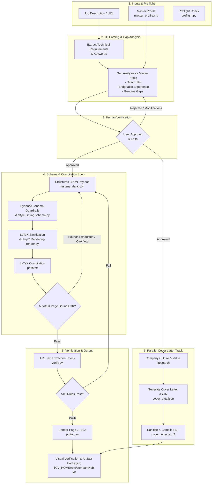

# Resume Tailor Skill Documentation

**Resume Tailor** is an AI agent skill that turns a job description and a candidate's master profile into ATS-verified, tailored resumes and matching cover letters compiled into publication-quality PDFs.

---

## Key Principles & Core Philosophy

1. **Code Decides Quality, LLM Writes Content**  
   The LLM generates resume content, but deterministic code controls layout constraints, character counts, ATS extraction, and PDF visual bounds. Page count and text alignment are verified against the compiled PDF—never estimated.
2. **Strict Schema Guardrails**  
   Layout overflow is prevented at the schema level. Pydantic schema validation enforces bullet point counts (e.g., maximum 4 per role) and length limits (e.g., maximum 120 characters per bullet).
3. **The Honesty Constraint**  
   * **Never fabricate skills or metrics:** If a skill is missing from the master profile, it is categorized as a genuine gap.
   * **Translate adjacent experience:** Existing experience is reframed using the job description's vocabulary (e.g., reframing a legacy migration project as scalable architecture).
   * **Traceable numbers:** All metrics and statistics must originate directly from the master profile.
4. **Human-in-the-Loop Verification**  
   Proposed reframings and gap fillings must be explicitly reviewed and approved by the user before resume compilation.

---

## Execution Workflow Diagram



---

## Prerequisites & Environment Setup

Before executing the skill, system dependencies must be validated via the preflight script:

```bash
python3 scripts/preflight.py
```

### System Dependencies
- **CLI Tools:** `pdflatex` (TeX Live / MacTeX), `pdftoppm` (Poppler utilities)
- **Python Libraries:** `pydantic`, `jinja2`, `pymupdf` (PyMuPDF / `fitz`), `python-docx` (optional for Word export)
- **User Files:**
  - `master_profile.md`: Single source of truth for candidate background (see `assets/master_profile.example.md`).
  - `$CV_HOME`: Destination environment variable (defaults to `~/cv`).

---

## Detailed Step-by-Step Execution

### 1. Job Description Extraction
- Fetches and stores the job posting verbatim as `job-description.md` inside the application output folder.
- Extracts technical keywords, preferred skills, core responsibilities, and seniority markers.

### 2. Gap Analysis & Technical Alignment
- Compares extracted requirements against the master profile.
- Produces three distinct categorizations:
  - **Direct Hits:** Exact skill matches from the candidate profile.
  - **Bridgeable Reframings:** Relevant adjacent experience mapped into the target role's terminology.
  - **Genuine Gaps:** Requirements missing from candidate history.

### 3. Human Verification Step
- Pauses execution to present proposed bullet points, vocabulary alignment, and reframings to the user.
- Requires explicit user approval before proceeding to artifact generation.

### 4. Schema Generation & Style Linting
- Constructs `resume_data.json` bound by constraints in `scripts/schema.py`.
- **Guardrails:** Max 4 bullets per role, max 120 characters per bullet point.
- **Style Rules (`lint_style()`):** Enforces active verbs, blocks passive wording, em-dashes, or fluff adjectives.

### 5. LaTeX Sanitization & Rendering
- Passes raw payload through LaTeX escaping (`%` $\rightarrow$ `\%`, `&` $\rightarrow$ `\&`, `$` $\rightarrow$ `\$`, etc.).
- Inject values into Jinja2 templates (`assets/resume.tex.j2`).
- Runs **Autofit Loop**: Compiles with `pdflatex` iteratively adjusting typography density (font size, margins, spacing) to guarantee exact page length without dropping content.

### 6. Automated ATS & Layout Verification
- Uses `scripts/verify.py` to inspect the compiled PDF:
  - Verifies raw text extraction via PyMuPDF.
  - Ensures section headers and chronological flow are preserved.
  - Verifies employer and date proximity (`dates_stay_with_employer`).
- Rejects build with non-zero exit code if layout or text extraction criteria fail.

### 7. Visual Inspection & Artifact Directory
- Renders high-resolution JPEG images of compiled PDF pages using `pdftoppm`.
- Stores final outputs under structured path:
  `$CV_HOME/<role>/<company>/<job-id>/`
  - `resume.pdf` & `resume.tex`
  - `resume_data.json` & `job-description.md`
  - `page-1.jpg`, `page-2.jpg`
  - `build-report.json`

### 8. Parallel Cover Letter Track
- Conducts targeted research on company culture and engineering values.
- Synthesizes technical cover letter framework into `cover_data.json`.
- Compiles companion PDF using `assets/cover_letter.tex.j2` through the same sanitization pipeline.

---

## Directory Structure & Script Index

```
.
├── SKILL.md                          # Main Skill Definition & Instruction Set
├── README.md                         # Architecture & Operational Documentation
├── assets/
│   ├── master_profile.example.md     # Example Master Profile Schema
│   ├── resume.tex.j2                 # Jinja2 LaTeX Template for Resumes
│   └── cover_letter.tex.j2           # Jinja2 LaTeX Template for Cover Letters
├── references/
│   ├── workflow.md                   # In-depth JD Extraction & Alignment Guide
│   └── troubleshooting.md            # Resolution guide for verification errors
└── scripts/
    ├── preflight.py                  # Environment & dependency check
    ├── build.py                      # Main orchestrator entry point
    ├── schema.py                     # Pydantic schemas, escaping & linting
    ├── render.py                     # LaTeX rendering & autofit compilation
    ├── render_docx.py                # Optional DOCX exporter
    └── verify.py                     # Automated ATS & layout verification tool
```

---

## Command Reference

### Preflight Check
```bash
python3 scripts/preflight.py
```

### Full Application Build
```bash
python3 scripts/build.py resume_data.json \
  --role ml-engineer \
  --company stripe \
  --job-id 4821 \
  --jd job-description.md \
  --cover cover_data.json
```

### Standalone PDF Audit
```bash
python3 scripts/verify.py resume.pdf
```

---

## Design Options: Date Alignment Trade-off

The skill supports two date formatting options in `resume_data.json`:

- `"date_style": "right"` *(Default)*  
  Flush-right dates using `\hfill`. Visually clean for human readers, though wide whitespace gaps may cause some raw text extractors to separate dates from employers.
- `"date_style": "inline"`  
  Formats headers as `Company | Location | Dates`. Guarantees employer and date remain adjacent during ATS text extraction. Recommended for automated enterprise ATS screening.

