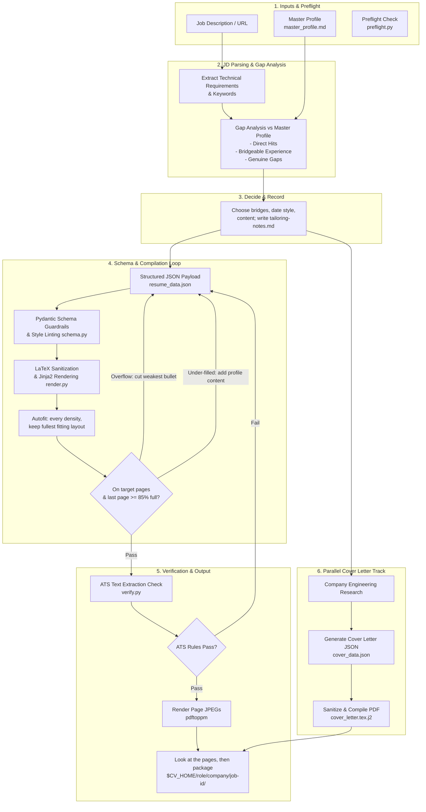

# Resume Tailor Skill Documentation

**Resume Tailor** is an Claude Code skill that turns a job description and a candidate's master profile into ATS-verified, tailored resumes and matching cover letters compiled into publication-quality PDFs.

---

## How to Use It

### 1. Download the latest release

Download the latest version from the [Releases](https://github.com/silentashish/claude-resume-generator-skill/releases/) page.

### 2. Install the skill

Go to your Claude Code skills directory:

```bash
cd ~/.claude/skills
```

Then extract the `resume-tailor.skill` file into this directory.

### 3. Add your resume and cover letter

Place your master resume and cover letter in the `~/cv` directory:

```text
~/cv/
├── master-profile.md
└── cover-letter.md
```

You can configure the skill to use a different directory if needed.

### 4. Tailor your resume

From Claude Code, simply run:

```text
/resume-tailor <link_to_job>
```

For example:

```text
/resume-tailor https://www.linkedin.com/jobs/view/123456789
```

The skill will analyze the job description, tailor your resume and cover letter, and generate the final output.

### 5. Find your tailored resume

The generated files will be organized by role, company, and job ID:

```text
~/cv/<role>/<company_name>/<job_id>/
```

For example:

```text
~/cv/software-engineer/acme/123456789/
```

---

## Key Principles & Core Philosophy

1. **Code Decides Quality, LLM Writes Content**  
   The LLM generates resume content, but deterministic code controls layout constraints, ATS extraction, page fill, and PDF visual bounds. Page count, page fill, and text alignment are verified against the compiled PDF, never estimated.
2. **Autonomous End to End**  
   The skill never pauses for approval. It makes every tailoring call itself (reframings, date style, what to include), records each one in `tailoring-notes.md` next to the PDF, and only stops when the build is clean and the rendered pages have been reviewed. The user reviews the finished document and the notes, not a plan.
3. **The Honesty Constraint**  
   * **Never fabricate skills or metrics:** If a skill is missing from the master profile, it is categorized as a genuine gap and left open.
   * **Translate adjacent experience:** Existing experience is reframed using the job description's vocabulary (e.g., reframing a legacy migration project as scalable architecture). Borderline reframings take the conservative wording and are flagged in the notes.
   * **Traceable numbers:** All metrics and statistics must originate directly from the master profile.
4. **Full Pages, Real Content**  
   A two-page target means two full pages. The build fails when the last page is under 85% used (`page_fill`), and the only accepted fix is more real content from the master profile: more bullets on recent roles at full length, a summary, projects, publications, certifications. Schema caps (8 bullets per role, 400 characters each) are sized so master-profile bullets carry over intact. Autofit picks the typography that lands on the target page count with the fullest last page; it never drops content.
5. **One Consistent Design**  
   Carlito (Calibri metrics), uppercase name, ruled uppercase section headings, the same two-line entry header in every section, small round bullets with hanging indents, blue underlined links, a name/page footer on page 2, and no entry header ever stranded at a page foot. Every spacing value comes from one autofit rung so the rhythm is even top to bottom.

---

## Execution Workflow Diagram



---

## Prerequisites & Environment Setup

Before executing the skill, system dependencies must be validated via the preflight script:

```bash
python3 scripts/preflight.py
```

### System Dependencies
- **CLI Tools:** `pdflatex` (TeX Live / MacTeX), `pdftoppm` and `pdftotext` (Poppler utilities)
- **LaTeX Packages:** `carlito`, `extsizes`, `ulem`, `fontaxes`, `microtype`, `titlesec`, `enumitem`, `hyperref`, `geometry`, `xcolor`; optional `needspace`, `fancyhdr`, and `mylatexformat` (preamble cache, roughly a 2x build speedup)
- **Environment variables:** `CV_HOME` (output root, default `~/cv`), `RESUME_TAILOR_JOBS` (parallel compiles, default CPU count), `RESUME_TAILOR_CACHE` (format cache dir, default `~/.cache/resume-tailor`), `RESUME_TAILOR_NO_FORMAT_CACHE=1` (disable the cache)
- **Python Libraries:** `pydantic`, `jinja2`, `pymupdf` (PyMuPDF / `fitz`), `python-docx` (optional for Word export)
- **User Files:**
  - `master_profile.md`: Single source of truth for candidate background (see `assets/master_profile.example.md`).
  - `$CV_HOME`: Destination environment variable (defaults to `~/cv`).

---

## Detailed Step-by-Step Execution

### 1. Job Description Extraction
- Fetches and stores the job posting verbatim as `job-description.md` inside the application output folder.
- Extracts technical keywords, preferred skills, core responsibilities, and seniority markers.

### 2. Gap Analysis & Technical Alignment
- Compares extracted requirements against the master profile.
- Produces three distinct categorizations:
  - **Direct Hits:** Exact skill matches from the candidate profile.
  - **Bridgeable Reframings:** Relevant adjacent experience mapped into the target role's terminology.
  - **Genuine Gaps:** Requirements missing from candidate history.

### 3. Decide & Record
- Chooses every reframing, the date style, and what to include, without pausing for approval.
- Writes `tailoring-notes.md` (direct hits, bridges with exact wording, gaps left open, content choices, layout decisions) so the user can audit each call next to the finished PDF.

### 4. Schema Generation & Style Linting
- Constructs `resume_data.json` bound by constraints in `scripts/schema.py`.
- **Guardrails:** Max 8 bullets per role, max 400 characters per bullet, sized so master-profile bullets carry over at full length.
- **Style Rules (`lint_style()`):** Flags hedging phrases, em-dashes, fluff adjectives, and bullets without a number.

### 5. LaTeX Sanitization & Rendering
- Passes raw payload through LaTeX escaping (`%` $\rightarrow$ `\%`, `&` $\rightarrow$ `\&`, `$` $\rightarrow$ `\$`, etc.).
- Injects values into Jinja2 templates (`assets/resume.tex.j2`).
- Runs the **Autofit Loop**: compiles every rung of a typography ladder (11pt to 9pt, 0.75in to 0.45in margins, leading, bullet and entry spacing), keeps the one that lands on the target page count with the fullest last page, then nudges leading upward until the last page ends at the margin. Content is never dropped.
- Keeps that loop fast: the LaTeX preamble is precompiled once per font size and cached under `~/.cache/resume-tailor`, attempts compile in parallel across CPU cores, and only the final render gets a second pdflatex pass. A full build is about 3.5s on four cores (first build on a machine about 1s more).

### 6. Automated ATS & Layout Verification
- Uses `scripts/verify.py` to inspect the compiled PDF:
  - Verifies raw text extraction via PyMuPDF and `pdftotext`.
  - Ensures section headers and chronological flow are preserved.
  - Measures the last page's fill (`page_fill`, hard failure under `min_fill`, default 85%).
  - Verifies employer and date proximity (`dates_stay_with_employer`) and that no header is stranded at a page foot (`no_orphan_headers`).
- Rejects the build with a non-zero exit code if any hard check fails, and prints a `next_step` naming the fix.

### 7. Visual Inspection & Artifact Directory
- Renders JPEG images of compiled PDF pages using `pdftoppm`, and the skill looks at them before delivering.
- Stores final outputs under structured path:
  `$CV_HOME/<role>/<company>/<job-id>/`
  - `resume.pdf` & `resume.tex`
  - `resume_data.json`, `job-description.md` & `tailoring-notes.md`
  - `resume-page-1.jpg`, `resume-page-2.jpg`
  - `build-report.json`
  - optionally `cover.pdf`, `cover_data.json`, `resume.docx`

### 8. Parallel Cover Letter Track
- Conducts targeted research on company culture and engineering values.
- Synthesizes technical cover letter framework into `cover_data.json`.
- Compiles companion PDF using `assets/cover_letter.tex.j2` through the same sanitization pipeline.

---

## Directory Structure & Script Index

```
.
├── SKILL.md                          # Main Skill Definition & Instruction Set
├── README.md                         # Architecture & Operational Documentation
├── assets/
│   ├── master_profile.example.md     # Example Master Profile Schema
│   ├── resume.tex.j2                 # Jinja2 LaTeX Template for Resumes
│   └── cover_letter.tex.j2           # Jinja2 LaTeX Template for Cover Letters
├── references/
│   ├── workflow.md                   # In-depth JD Extraction & Alignment Guide
│   └── troubleshooting.md            # Resolution guide for verification errors
└── scripts/
    ├── preflight.py                  # Environment & dependency check
    ├── build.py                      # Main orchestrator entry point
    ├── schema.py                     # Pydantic schemas, escaping & linting
    ├── render.py                     # LaTeX rendering & autofit compilation
    ├── render_docx.py                # Optional DOCX exporter
    └── verify.py                     # Automated ATS & layout verification tool
```

---

## Command Reference

### Preflight Check
```bash
python3 scripts/preflight.py
```

### Full Application Build
```bash
python3 scripts/build.py resume_data.json \
  --role ml-engineer \
  --company stripe \
  --job-id 4821 \
  --jd job-description.md \
  --notes tailoring-notes.md \
  --cover cover_data.json
```

### Standalone PDF Audit
```bash
python3 scripts/verify.py resume.pdf
```

---

## Design Options: Date Alignment Trade-off

The skill supports two date formatting options in `resume_data.json`:

- `"date_style": "inline"` *(Default)*  
  Bold dates after the italic title (`Title | Dates`). Guarantees employer and date remain adjacent during ATS text extraction. Recommended for automated enterprise ATS screening.
- `"date_style": "right"`  
  Flush-right dates using `\hfill`. Traditional for human readers, though wide whitespace gaps may cause some raw text extractors to separate dates from employers.

The skill picks one itself and records the reason in `tailoring-notes.md`.

## Page Fill

`"target_pages"` (1 or 2) and `"min_fill"` (default `0.85`) control the page budget. The build fails when the last page is less full than `min_fill`; the intended fix is more real content from the master profile, and the console `next_step` says exactly what to add. Lower `min_fill` or drop to one page only when the profile is genuinely exhausted.

